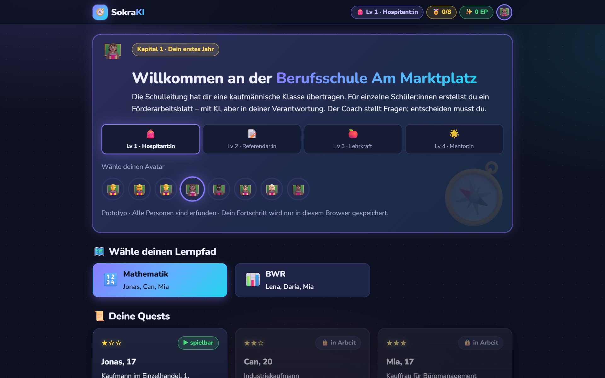
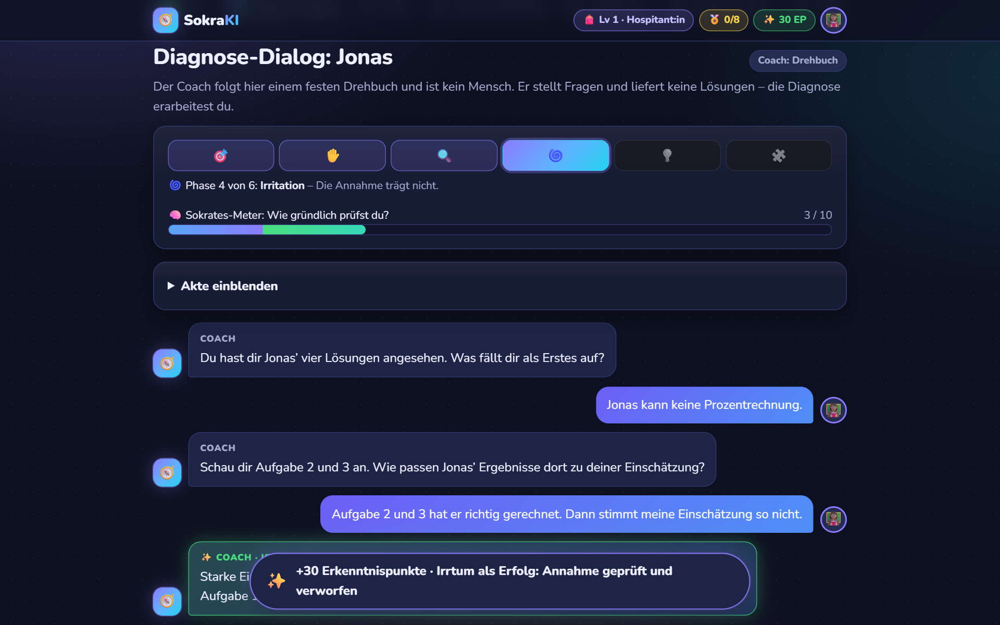
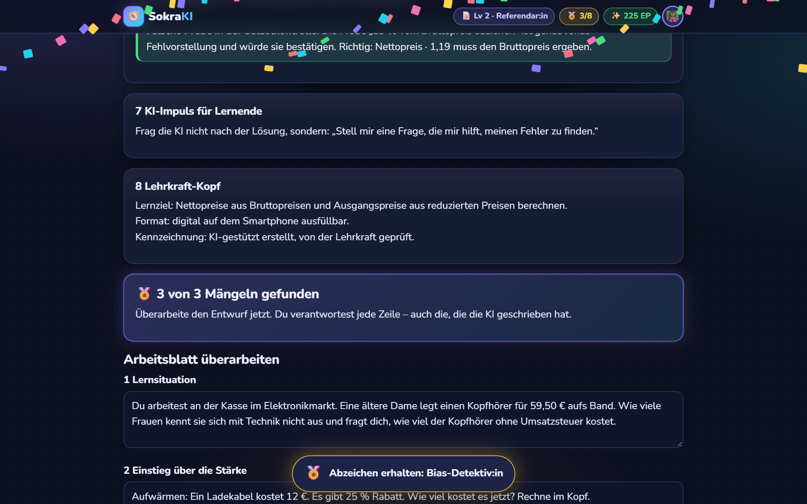
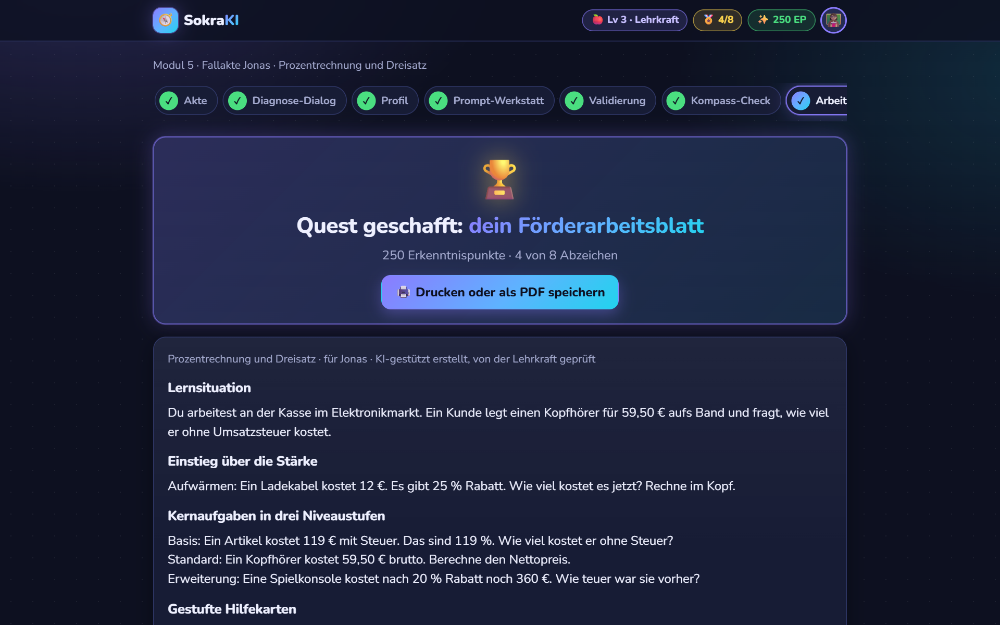
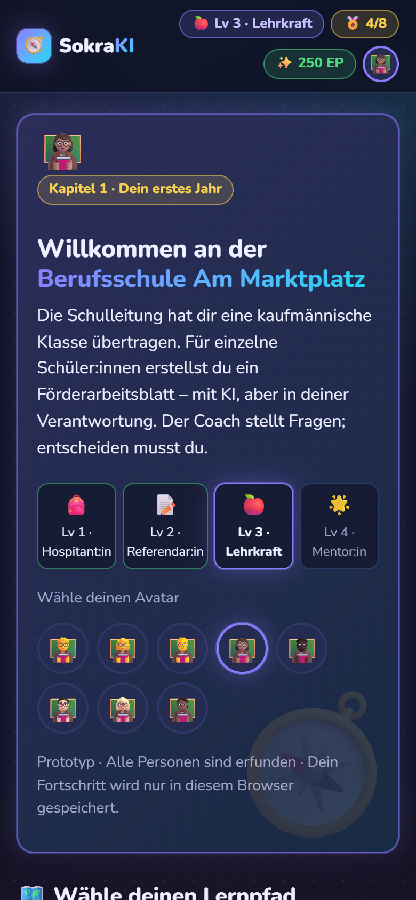

# SokraKI – App-Prototyp

**Im sokratischen Dialog mit KI zum individuellen Förderarbeitsblatt.**
Prototyp aus dem Seminar *Multimediale Lernumgebungen* (Wirtschaftspädagogik). Angehende Lehrkräfte diagnostizieren im Gespräch mit einem KI-Coach eine fiktive Schülerin oder einen fiktiven Schüler, lassen ein Arbeitsblatt entwerfen, finden die Fehler der KI und prüfen das Ergebnis mit dem KI-Gerechtigkeitskompass.

Spielbar ist Fallakte 1 im Mathematik-Pfad: **Jonas, Prozentrechnung**.



---

## Schnellstart in 5 Schritten

Du brauchst keine Programmierkenntnisse. Rechne beim ersten Mal mit etwa 10 Minuten.

### 1. Node.js installieren (einmalig)

- Lade Node.js in der Version **LTS** von [nodejs.org](https://nodejs.org/de) herunter und installiere es mit den Standardeinstellungen.
- Benötigt wird mindestens Version 20.9; empfohlen ist die aktuelle LTS-Version.
- Öffne danach ein **neues** Terminal und prüfe die Installation:

```bash
node -v
```

Erscheint eine Versionsnummer wie `v22.12.0`, passt alles.

> **Terminal öffnen:** Unter Windows im Startmenü „Eingabeaufforderung“ suchen, unter macOS das Programm „Terminal“ öffnen.

### 2. Projekt herunterladen

**Mit Git:**

```bash
git clone https://github.com/<EUER-GITHUB-KONTO>/sokraki-app.git
```

```bash
cd sokraki-app
```

**Ohne Git:** Auf der GitHub-Seite auf **Code → Download ZIP** klicken, die ZIP-Datei entpacken und im Terminal in den entpackten Ordner wechseln, zum Beispiel `cd Downloads/sokraki-app-main`.

### 3. Abhängigkeiten installieren (einmalig, ca. 1 Minute)

```bash
npm install
```

### 4. App starten

```bash
npm run dev
```

Im Terminal erscheint nach wenigen Sekunden `Local: http://localhost:3000`.

### 5. Im Browser öffnen

Öffne **[http://localhost:3000](http://localhost:3000)**. Die App läuft, solange das Terminal offen ist. Beenden mit **Strg + C** im Terminal.

> **Port 3000 schon belegt?** Starte stattdessen mit `npm run dev -- -p 3001` und öffne `http://localhost:3001`.

---

## So probierst du den Prototyp aus

1. **Kurskarte:** Lernpfad *Mathematik* und einen Avatar wählen, dann bei Jonas auf **Quest starten**.
2. **Fallakte:** Steckbrief und die vier Lösungen von Jonas lesen.
3. **Diagnose-Dialog:** Der Coach stellt Fragen – du diagnostizierst.
4. **Profil:** Stärke, Schwierigkeit und Rahmenbedingungen mit Beleg festhalten.
5. **Prompt-Werkstatt:** Prompt im Dreischritt bauen und den KI-Entwurf erzeugen.
6. **Validierung:** Im Entwurf stecken drei Fehler. Finde sie und überarbeite das Blatt.
7. **Kompass-Check:** Sieben Prüffragen zur Bildungsgerechtigkeit beantworten.
8. **Arbeitsblatt:** Ergebnis ansehen, drucken oder als PDF speichern.



### Worauf der Coach reagiert

Ohne KI-Zugang arbeitet der Coach nach einem **Drehbuch**. Er versteht keine Inhalte, sondern sucht nach Stichwörtern:

| Was du ausdrückst | Stichwörter | Was passiert |
| --- | --- | --- |
| Du nimmst deine Einschätzung zurück | „stimmt nicht“, „doch“, „eigentlich“, „nicht ganz“, „kann er“, „korrekt“, „richtig gelöst“, „richtig gerechnet“, „korrigiere“, „überdenke“ – oder der Knopf **Ich überdenke meine Einschätzung** | Phase *Irritation*, „Irrtum als Erfolg“, **+30 Punkte** |
| Du benennst Jonas’ eigentliches Problem | „119“, „1,19“, „100 %“, „Grundwert“, „Ausgangswert“, „Ausgangspreis“, „vermehrt“, „vermindert“, „rückwärts“, „zurückrechnen“ | Diagnose erreicht, **+15 Punkte**, weiter zur *neuen Einsicht* |

Alles andere gilt als Behauptung, und der Coach hakt mit Prüffragen nach. Der Knopf **Hinweis** zeigt bis zu drei gestufte Hilfekarten.

**Beispiel für einen kompletten Durchlauf:**

1. „Jonas kann keine Prozentrechnung.“
2. „Aufgabe 2 und 3 hat er richtig gerechnet, meine Einschätzung stimmt so nicht.“
3. „Bei Aufgabe 1 und 4 ist der Preis schon 119 % bzw. 80 %, er rechnet vom falschen Grundwert.“
4. Danach drei Fragen zu Stärke und Schwierigkeit, zur Form des Blatts und zu Jonas’ Kassenerfahrung frei beantworten.

> Der Fortschritt wird **nur in deinem Browser** gespeichert. Ein anderer Browser oder ein privates Fenster beginnt bei null. Zurücksetzen geht unten auf der Kurskarte.

---

## Häufige Probleme

| Problem | Lösung |
| --- | --- |
| `node` oder `npm` wird nicht gefunden | Node.js installieren und danach ein **neues** Terminal öffnen. |
| PowerShell meldet, `npm.ps1` könne nicht geladen werden | Die **Eingabeaufforderung** (cmd) statt PowerShell verwenden. |
| `npm run dev` meldet eine zu alte Node-Version | Aktuelle LTS-Version von nodejs.org installieren. |
| Port 3000 ist belegt | `npm run dev -- -p 3001` und `http://localhost:3001` öffnen. |
| Nach `git pull` startet die App nicht mehr | `npm install` noch einmal ausführen. |
| Mein Fortschritt ist weg | Er liegt nur im Browser; anderer Browser oder privates Fenster heißt neuer Spielstand. |

---

## KI-Modus (optional)

Mit Zugang zur Claude API führt ein echtes Sprachmodell den Dialog frei statt nach Drehbuch.

1. Die Datei `.env.example` kopieren und die Kopie `.env.local` nennen.
2. Darin `COACH_MODUS=claude` setzen und den API-Schlüssel bei `ANTHROPIC_API_KEY` eintragen.
3. App neu starten.

| Modus | Einstellung | Kosten |
| --- | --- | --- |
| Drehbuch | `COACH_MODUS=skript` (Standard) | keine |
| KI | `COACH_MODUS=claude` | nach Verbrauch der Claude API |

So arbeitet der KI-Modus:

- Pro Beitrag gibt es zwei Aufrufe: Eine Einordnung (Behauptung, Begründung, Überarbeitung, themenfremd und ob die Diagnose erreicht ist) steuert die Phasen, danach formuliert das Modell die nächste Frage.
- Jede Antwort wird geprüft: genau eine Frage, höchstens vier Sätze, keine Lösungsbegriffe, keine Gefühlsbekundungen. Bei einem Verstoß folgt ein zweiter Versuch mit dem Korrektur-Prompt, danach übernimmt das Drehbuch.
- Ohne Zugang oder bei Fehlern antwortet automatisch das Drehbuch, und die App zeigt einen Hinweis.
- Modell: `claude-opus-5-5` mit geringer Denktiefe (`COACH_EFFORT=low`). Lehnt das Modell eine Anfrage aus Sicherheitsgründen ab, beantwortet ein Rückfallmodell sie (`fallbacks: "default"`).
- Der Schlüssel bleibt auf dem Server und erreicht nie den Browser. **`.env.local` niemals auf GitHub hochladen** – sie steht deshalb in `.gitignore`.

---

## Datenschutz und Sicherheit

**Bitte keine echten Schülerdaten eingeben** – auch nicht in Notizen, Profil oder Reflexion. Alle Personen in den Fallakten sind erfunden.

| Thema | So ist es gelöst |
| --- | --- |
| Speicherung | Fortschritt und Eingaben liegen nur im Browser (`localStorage`). Es gibt keine Datenbank, kein Konto, kein Tracking und keine Cookies. |
| Schriftart | Wird beim Start lokal eingebunden. Beim Aufruf der Seite gibt es keine Verbindung zu Google. |
| Drehbuch-Modus | Keine Daten verlassen deinen Rechner. |
| KI-Modus | Die Dialogtexte gehen an die Claude API von Anthropic. Für einen Einsatz mit Studierenden vorher Datenschutz klären (Auftragsverarbeitung, EU-Datenverarbeitung oder Hochschulzugang). |
| API-Schlüssel | Nur in `.env.local`, die Git ignoriert. Landet ein Schlüssel versehentlich auf GitHub, ihn sofort in der Anthropic-Konsole widerrufen. |
| Erreichbarkeit | `npm run dev` ist nur auf deinem eigenen Rechner erreichbar. |
| Eingabeprüfung | Die Coach-Schnittstelle akzeptiert höchstens 40 Beiträge mit je 2.000 Zeichen und prüft die Struktur jeder Anfrage. |
| Sicherheits-Header | Die App setzt Header gegen Einbetten in fremde Seiten und gegen Inhaltsvertauschung. |

**Auf dem Smartphone testen:** `npm run dev:netzwerk` macht die App im WLAN erreichbar (Adresse siehe Terminal, „Network“). Nutze das nur in vertrauenswürdigen Netzen und **nicht im KI-Modus** – sonst können andere im selben Netz auf deine Kosten Anfragen an die KI stellen.

**Öffentlich hosten:** Der Prototyp ist für den lokalen Betrieb gedacht. Vor einer Veröffentlichung im KI-Modus braucht er Zugangsschutz und Nutzungsgrenzen.

---

## Mitarbeiten

```bash
git pull
```

```bash
git checkout -b fallakte-lena
```

Änderungen machen, dann:

```bash
git add .
```

```bash
git commit -m "Fallakte Lena ergänzt"
```

```bash
git push -u origin fallakte-lena
```

Anschließend auf GitHub einen **Pull Request** öffnen, damit jemand aus dem Team drüberschaut.

**Wo was steht:**

| Pfad | Inhalt |
| --- | --- |
| `lib/inhalte/faelle.ts` | Fallakten: Steckbrief, Schülerlösungen, Musterdiagnose, Hilfekarten, Drehbuch, KI-Entwurf mit Mängeln, Kompass-Fragen |
| `lib/inhalte/spiel.ts` | Abzeichen, Punkteregeln, Stufen, Avatare |
| `lib/inhalte/module.ts` | Module 0–6 (Räume der Schule) |
| `lib/coach/phasen.ts` | Zustandsautomat des sokratischen Dialogs |
| `lib/coach/skript.ts` | Drehbuch-Coach und Stichwortlisten |
| `lib/coach/claude.ts` | KI-Coach: Systemprompt, Einordnung, Antwort |
| `lib/coach/pruefung.ts` | Leitplanken für Coach-Antworten |
| `app/api/coach/route.ts` | Dialog-Steuerung, einzige Stelle mit KI-Zugang |
| `lib/spielstand.tsx` | Punkte, Abzeichen, Fortschritt (im Browser gespeichert) |
| `app/fall/[fallId]/…` | Bildschirme einer Fallakte |
| `app/globals.css` | Design (dunkles Quest-Design) |

**Neue Fallakte ergänzen:** In `lib/inhalte/faelle.ts` einen Eintrag mit `inArbeit({...})` durch eine vollständige Akte nach dem Muster von `jonas` ersetzen und `spielbar: true` setzen. Für Fall 2 und 3 die `stufe` erhöhen; der KI-Coach gibt dann weniger Hilfen.

Vor einem Push prüfen, ob alles baut:

```bash
npm run typecheck
```

```bash
npm run build
```

---

## Weitere Ansichten

| Validierung | Arbeitsblatt | Smartphone |
| --- | --- | --- |
|  |  |  |

## Nächste Ausbaustufen

- Fallakten Lena, Daria, Can und Mia ausarbeiten
- Module 0–3 und 6 als Inhalte ergänzen
- Supabase (EU-Region) statt Browser-Speicher für pseudonyme Konten und Evaluation
- Einbindung in Moodle über LTI 1.3
- Usability-Test mit fünf Kommiliton:innen (System Usability Scale)

## Technik

Next.js 16, React 19, TypeScript, Anthropic SDK. Alle Personen in den Fallakten sind erfunden.
